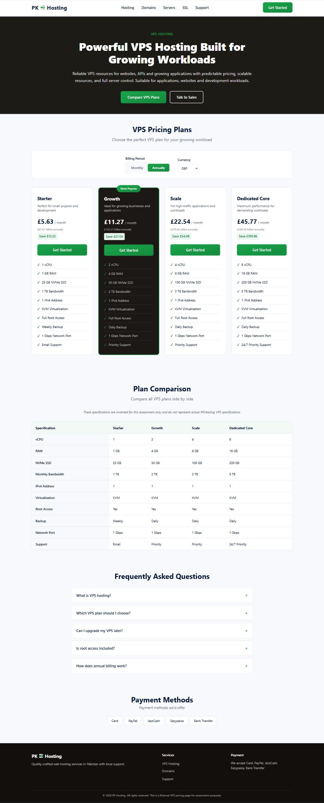

# PKHosting VPS Pricing

## Overview

This is a fictional VPS pricing page created for the TechAbout assessment.

## Screenshots

### Desktop (1440px)



## How to run

Simply open:

```
index.html
```

No build step required. The page works completely offline.

## Technologies

- HTML5
- CSS3
- Vanilla JavaScript

## Features

- Responsive pricing cards (4 plans)
- Monthly/Annual billing toggle with JavaScript-calculated annual prices
- PKR/USD/GBP currency selector
- localStorage persistence for user preferences
- Complete comparison table
- Accessible FAQ with native HTML `<details>` elements
- Keyboard navigation support
- Visible focus states
- ARIA live region for price announcements
- Offline support - no external network requests
- Works without JavaScript (progressive enhancement)

## Browsers tested

- Chrome
- Firefox

## Responsive testing

- 360px (Mobile)
- 768px (Tablet)
- 1440px (Desktop)
- 200% zoom

## JavaScript disabled

When JavaScript is disabled:
- Hero section remains visible
- CTA buttons remain visible
- All four pricing cards remain visible with monthly PKR prices
- Full comparison table remains visible
- FAQ content remains visible
- Footer remains visible
- Billing toggle and currency selector still present but non-functional
- Prices remain in PKR monthly format

## Offline testing

No external requests are made. All resources (HTML, CSS, JavaScript) are local files. The page can be opened directly from the filesystem.

## What is unfinished

Nothing required by the brief is intentionally unfinished.

## AI disclosure

AI assistance was used during development for planning, code structure guidance, and reviewing implementation. All submitted code was reviewed and tested by the author.
